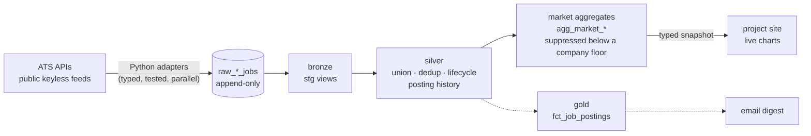

# Job Market Analytics

End-to-end **Analytics Engineering** project that measures what a tracked set of company job
boards is hiring for: how many postings are open, how long they stay up, which role families
they fall into, and which tools data roles ask for. Typed Python ingestion from every ATS with
a public keyless feed lands raw postings twice a day; a **dual-target dbt project** (DuckDB
dev / BigQuery prod) dedupes, lifecycle-tracks and versions them; suppressed aggregates feed
live charts on the project site.

### **→ [Project site](https://amikhno.github.io/job-market-analytics/)**



## What the charts measure

Each chart is one dbt model in gold, rebuilt on every run and published only where a figure
rests on enough distinct companies (ADR-0029). The boards are a curated list rather than a
sample of the labour market, and the site says so.

| Chart | Model | What makes it more than a count |
|---|---|---|
| Open and new postings over time | `agg_market_daily` | Normalized by boards read that day, so adding a company does not read as a hiring surge; postings already up at a board's first read are not counted as new |
| How long a posting stays up | `agg_market_tenure` | A Kaplan-Meier survival curve, not an average: postings still open stay in the at-risk set instead of biasing the figure short |
| Role families | `agg_market_roles` | Open postings per family, with how each states its work location |
| What data roles ask for | `agg_market_tech` | Share of open data-role postings naming each technology; one withheld when a single employer accounts for it |
| ATS mix | `agg_market_ats` | A system below the floor folds into "other", so totals still add up |

The aggregates read upstream of every filter, the export re-validates each row against a typed
schema before anything leaves the warehouse, and the workflow that can read the warehouse is
not the one that can publish the site. The reasoning is in
[ARCHITECTURE.md](ARCHITECTURE.md#market-aggregates).

The site also carries the design decisions, rendered docs and all 30 ADRs, and the dbt lineage DAG. <!-- check:adrs -->
It is rebuilt in CI on every push to main, or locally with `make site` (output in `_site/`). Every
number on the landing page is read from the dbt manifest, the ADRs and the test suite at build
time, and the build fails on a broken link. Every PR's CI run also uploads a `site-preview`
artifact, so a change to the site can be reviewed before it merges.

## Quickstart

Prerequisite: [uv](https://docs.astral.sh/uv/) (the only one — it installs Python 3.14
itself, per `.python-version`).

```bash
curl -LsSf https://astral.sh/uv/install.sh | sh   # macOS/Linux; or: brew install uv

make install                  # uv venv + pre-commit hooks
cp .env.example .env          # ingestion needs no secrets; fill BQ vars only for prod
cp config/companies.example.csv config/companies.csv   # your PRIVATE company list (gitignored)
# dbt/profiles.yml is committed (env-var driven, no secrets) — nothing to copy

make ingest                   # Python -> raw tables (DuckDB by default)
make dbt-dev                  # bronze -> silver -> gold on DuckDB
make test && make dbt-test
```

## Structure

```
ingest/      per-ATS adapters, source registry, parallel pipeline entrypoint
shared/      config (Pydantic Settings), models, http, storage (one writer, both warehouses)
deliver/     market snapshot export for the site; email digest of new postings
config/      private company list (gitignored; .example committed)
dbt/         one dual-target project: models/{bronze,silver,gold}, snapshots, seeds, macros, unit tests
scripts/     repo gates that are not lint or tests (see below), and the Pages site build
site/        landing page template + docs theme for the Pages site
tests/       pytest suite + sanitized fixtures
docs/        decisions/, v2-plan.md, research/  (ARCHITECTURE.md at repo root)
.github/     four workflows, split by permission scope — see ARCHITECTURE.md#automation
```

Currently 9 ingestion sources, 25 dbt models and 30 ADRs. <!-- check:sources check:dbt_models check:adrs -->

## Quality gates

Every invariant this project relies on is enforced by something that fails, not by intent.
`make lint` and `make test` run locally, in a pre-commit/pre-push hook, and again in CI, which
blocks merge:

| Gate | Guards against |
|---|---|
| `ruff check` + `ruff format` | style drift, unused code, import order |
| `mypy --strict` | untyped defs; no `Any` crossing a module boundary |
| `sqlfluff` | dbt SQL style, against the compiled models |
| `pytest` with `--cov-fail-under=85` | untested behavior; the gate is never lowered to pass |
| dbt schema + unit tests | model contracts (`not_null`, `unique`, `accepted_values`) |
| `dbt source freshness` | a source that silently stopped landing rows |
| **`scripts/check_docs.py`** | **documentation that points at things which no longer exist** |
| `gitleaks` | committed secrets |
| `actionlint` | a workflow that fails validation — which does not fail loudly: it stops running on its schedule and sends no alert, because no run ever starts |
| Dependabot | stale dependencies (`uv.lock` + `pyproject.toml` together) |

The docs check is the unusual one. Prose drifts silently — a file is renamed, a make target goes
away, an ADR is superseded, and the sentence referring to it still reads fine, because nothing in
a test suite imports a paragraph. It verifies the references that are mechanically checkable
(relative links, repo paths, line-anchored refs, ADR numbers, make targets, dbt model names,
heading anchors) across both markdown and Python docstrings, and lets a doc assert a number
against the code with an inline `<!-- check:… -->` marker, so a count cannot rot under an edit.
Deliberate exceptions live in `scripts/planned-refs.txt`; everything else failing is drift.

## Stack

Python 3.14 + Pydantic v2 · dbt-core with dbt-duckdb (dev) and dbt-bigquery (prod) ·
GitHub Actions (twice-daily ingest, freshness gate, market snapshot, site publish).

## Status & roadmap

**0.2.0 in production** — twice-daily ingestion to BigQuery, transform, freshness gate, posting
history as an SCD2 snapshot (ADR-0030), and the market aggregates behind the site's charts.

**Also in the pipeline: relevance ranking.** The same postings are rule-filtered, ranked and
delivered as an email digest of what is new. Typed extraction and a 1–5 fit score run as dbt
models against BigQuery's in-SQL AI functions, and the score *orders* delivery without ever
filtering it (ADR-0020). An embedding ranking is built to run beside the LLM one, because
choosing between them without measuring is how a project ends up carrying both forever.

**That ranking is deliberately unvalidated so far.** `make evaluate` scores a ranking by
precision@k against human labels, and labels from an LLM cannot settle it: grading a scorer
against its predecessor's judgements rewards reproducing that predecessor's mistakes. Both
rankings are kept until labels exist *and* a month of live runs has shown the winner stays the
winner; only then does the loser get deleted.

Full design: `ARCHITECTURE.md`. What is next: `TODO.md`.

## License

Personal project. Not currently licensed for redistribution.
